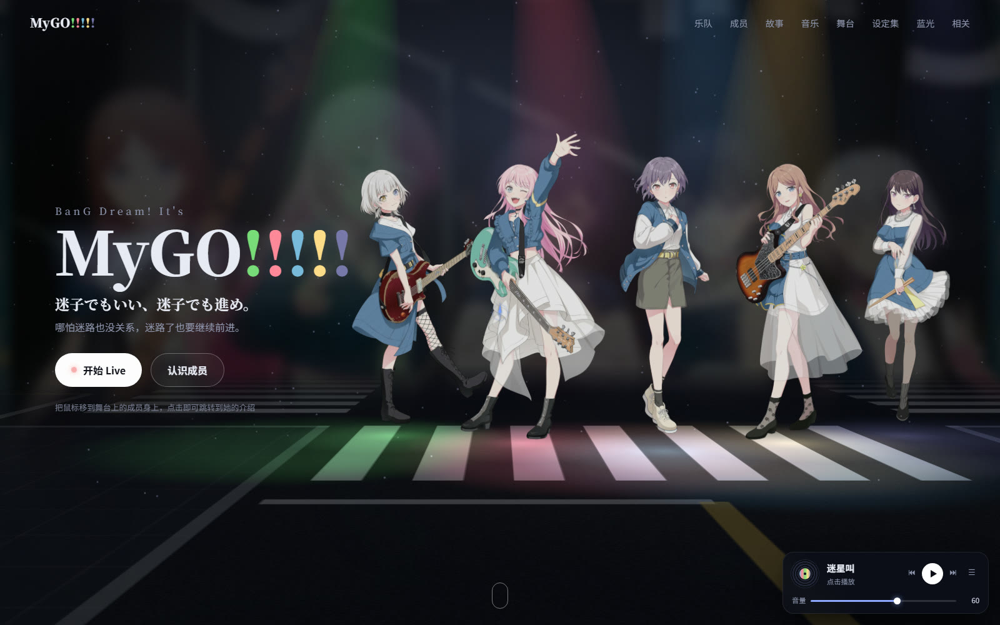
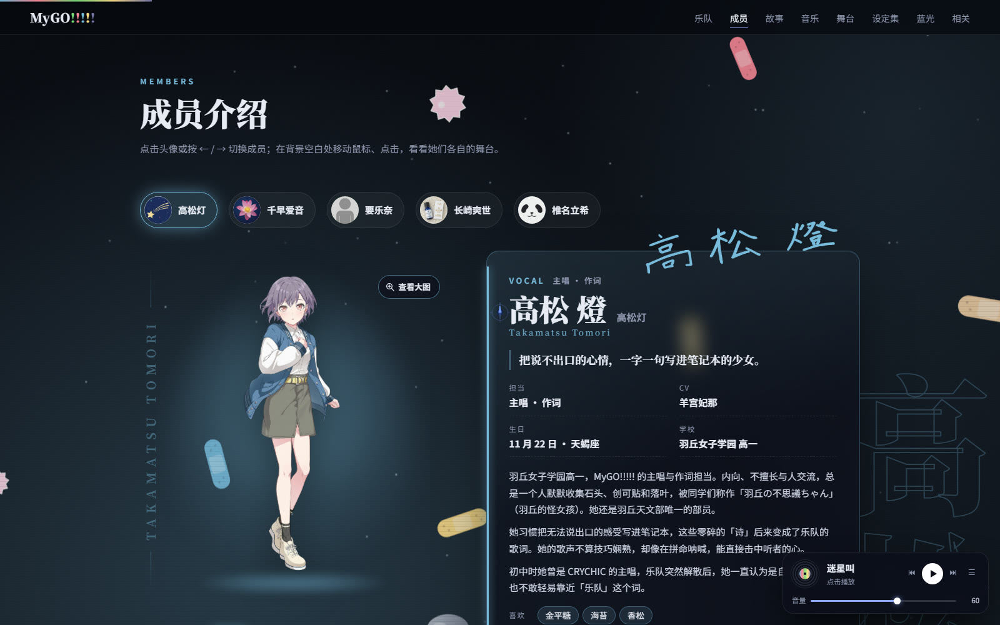
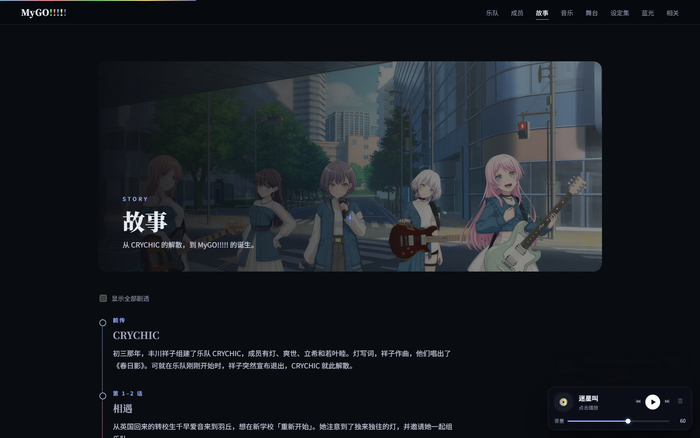
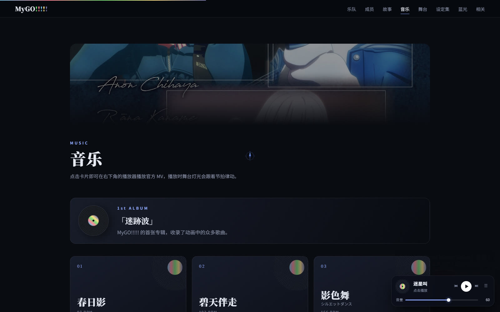
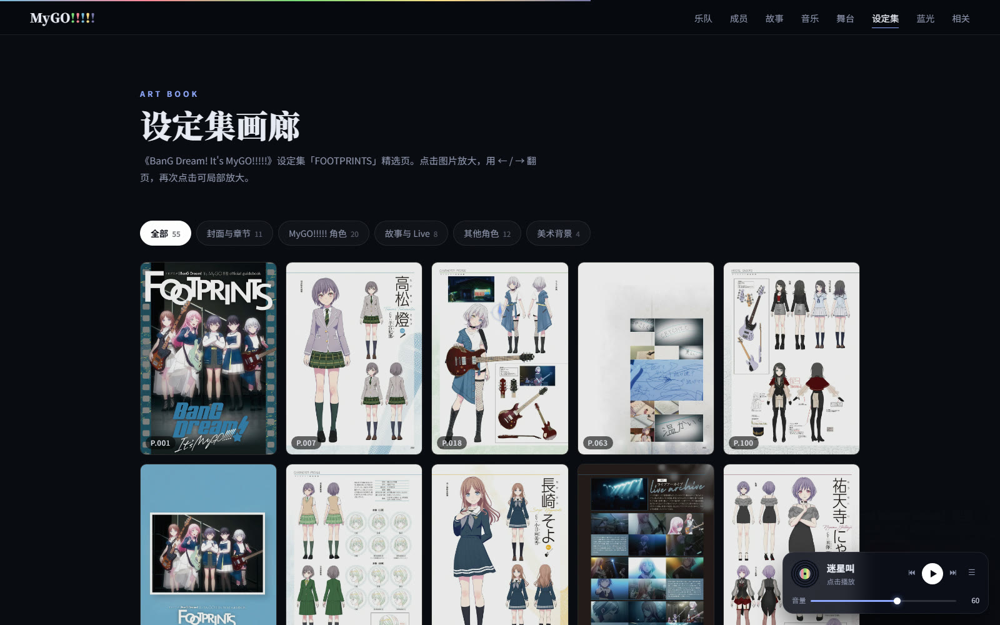
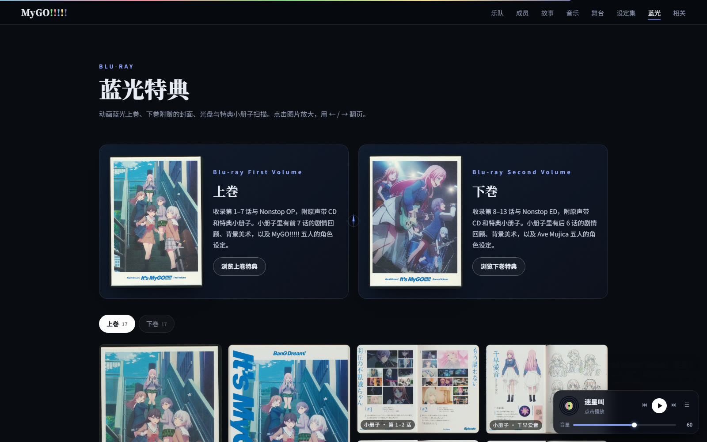

# MyGO!!!!! 介绍页（工程源码）

《BanG Dream! It's MyGO!!!!!》的粉丝介绍网页，深色 Live 风格，使用 HTML + CSS + 原生 JS + Three.js，不需要构建工具。

**在线浏览：<https://rockau.github.io/MyGO/>**



> 本项目为粉丝制作的非商业作品，**源码以 PolyForm Noncommercial 1.0.0 授权，禁止商用**。
> 角色立绘、设定集与蓝光扫描、音乐与视频的版权均归 ©BanG Dream! Project / ©Bushiroad 所有，详见 [NOTICE.md](NOTICE.md)。

## 功能

- **首屏 3D 舞台**：五人演出服立绘配代表色聚光灯。播放音乐后切换成 Live 摇头灯，按 BPM 扫动。
- **成员介绍**：每人一块专属的 Three.js 背景板和一个自定义鼠标（星星、爱心、拨片、红茶杯、鼓棒），四种服装切换，资料卡、设定集原稿、小知识翻转卡片。
- **背景音乐**：嵌入官方 YouTube MV。演出画面可以折叠、展开小窗、或模糊后铺满舞台；可调节音量和模糊度。
- **其他内容**：故事时间轴（剧透折叠）、歌曲卡片、舞台与街景、设定集画廊、蓝光特典、CRYCHIC 与 Ave Mujica。

## 页面一览

### 成员介绍

点击头像或按 ← / → 切换成员，每人都有一块会跟随鼠标的专属背景板、四种服装和可翻转的资料卡片。



### 故事

从 CRYCHIC 的解散到 MyGO!!!!! 的诞生，按话数排列的时间轴，剧透默认折叠。



### 音乐

专辑与歌曲卡片，点击即可在右下角播放器播放官方 MV，播放时舞台灯光跟着节拍律动。



### 设定集画廊

设定集「FOOTPRINTS」精选页，支持分类筛选、点击放大、← / → 翻页、再次点击局部放大。



### 蓝光特典

动画蓝光上巻、下巻附赠的封面、光盘与特典小册子扫描。



## 本地运行

需要 Node.js。双击 `启动.bat`，或者在项目目录里执行：

```
node serve.mjs
```

然后打开 <http://localhost:8000>。页面用到了 ES module，直接双击 `index.html` 无法运行。

## 目录结构

| 路径 | 内容 |
|---|---|
| `index.html` / `style.css` | 页面骨架与样式 |
| `js/data.js` | 成员资料、歌曲、故事、页码映射等所有文字数据 |
| `js/main.js` | 页面渲染、成员切换、灯箱、画廊 |
| `js/stage.js` | 首屏 Three.js 舞台 |
| `js/memberBg.js` | 成员专属背景板 |
| `js/cursor.js` | 成员区的自定义鼠标 |
| `js/player.js` | YouTube 播放器、节拍时钟、音量与模糊度设置 |
| `build-site.mjs` | 生成只含所需图片的发布目录：`node build-site.mjs [输出目录]` |
| `make-media.mjs` | 生成页面用到的缩略图与视频素材 |
| `docs/screenshots/` | README 里用的页面截图 |

设定集和蓝光扫描只收录了网页用到的页。

## 授权

- **代码**（HTML / CSS / JS / 构建脚本）：[PolyForm Noncommercial License 1.0.0](LICENSE)
  - 可以自由学习、修改、分发，**仅限非商业用途**
  - 分发时请保留 `LICENSE` 与 `NOTICE.md`
- **素材**（立绘、设定集扫描、蓝光特典、音乐与视频）：版权归 ©BanG Dream! Project / ©Bushiroad，**不在代码授权范围内**，仅用于本非商业粉丝项目
- **字体**：`fonts/` 下为思源宋体（Noto Serif SC）子集，遵循 SIL Open Font License 1.1

完整说明见 [NOTICE.md](NOTICE.md)。

## 版权

本项目为粉丝制作的非商业作品。角色立绘、设定集与蓝光扫描图片、音乐与视频的版权均归 ©BanG Dream! Project / ©Bushiroad 所有。
